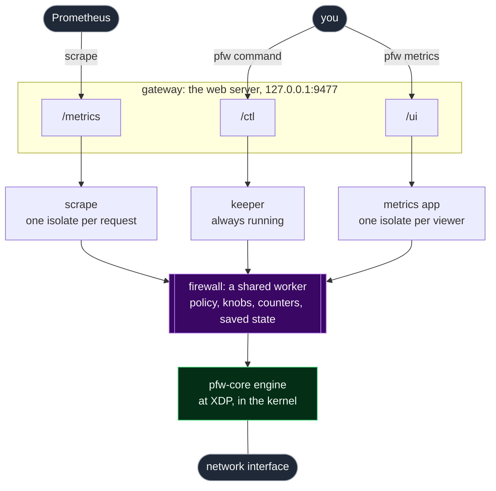

# pfw

A firewall for Linux that reads what is *inside* network traffic, not just
where it comes from, and stops what you tell it to.

You give it a **policy**: a short file of rules such as "reset any web request
whose user-agent is an AI crawler". pfw runs that policy on every packet as it
arrives at the network card, before the rest of the system sees it, and shows
you what it let through and what it stopped.

```
 pfw ● up 3d 4h · eth0 · rules:http/crawlers.pfc @ b58a001                 seen 1.23M · blocked 4.4k
 1 overview    2 rules    3 timing    4 engine
─━━━━━━━━━━──────────────────────────────────────────────────────────────────────────────────────────
╭─ traffic ────────────────────────────────────────────────────── 67/s · peak 81/s · mean 47/s ─╮
│         ▅▅▅▅        ███████        ████           ▆▆▆▆   pass ████████████▉░░  1.19M  96.7%   │
│         ████▂▂▂▂▂▂▂▂███████        ████▇▇▇▇       ████   drop ░░░░░░░░░░░░░░░    312   0.0%   │
│ ▃▃▃▃▃▃▃▃███████████████████▂▂▂▂▂▂▂▂████████▇▇▇▇▇▇▇████   rst  ▍░░░░░░░░░░░░░░   4.1k   0.3%   │
╰───────────────────────────────────────────────────────────────────────────────────────────────╯
```

- **Policies come from git.** Point pfw at a repository of them, pull, pick
  one, apply it. A [public set](https://github.com/yeet-src/pfw-rules) is
  there to begin with.
- **You can try a policy before trusting it.** In *shadow mode* it decides
  and counts as usual and blocks nothing, so you see what it would have done.
- **Changes are live.** Applying a policy, or changing a value it reads, takes
  effect on the next packet. Nothing restarts, and no connection is dropped
  for it.
- **It tells you what it is doing**: a dashboard in your terminal, and
  metrics for Prometheus.

## Install

You need a Linux machine, with kernel 6.1 or newer.

```sh
curl -fsSL https://raw.githubusercontent.com/yeet-src/pfw/master/install.sh | sh
```

That checks your machine, installs [yeet](https://yeet.cx) (which pfw runs
on) if you do not have it, asks you to log in, installs the `pfw` command
and starts the firewall, **blocking nothing** until you give it a policy.
More in [Installing](docs/install.md).

## Quick start

```sh
pfw doctor            # is everything in place?
pfw interfaces        # which interface is which
pfw attach eth0       # the one to protect
pfw pull              # download the public policies
pfw ls                # list them
pfw shadow            # dry run on: decide and count, block nothing
pfw apply rules:http/crawlers.pfc   # put a policy in place
pfw status            # "would block N" is what it would have stopped
pfw unshadow          # make it real
pfw metrics           # the dashboard
```

[Getting started](docs/getting-started.md) walks through each of those with
what you should see. For a machine with real traffic on it, follow
[Deploying, step by step](docs/deploy.md). Or let a coding agent do it:
[Setting up with an AI agent](docs/agents.md).

## How it works

<!-- diagram: architecture -->

<!-- /diagram -->

The `pfw` command talks to a service that owns the firewall; the firewall
runs your policy in the kernel, on the interfaces you attached it to. More in
[How it works](docs/architecture.md).

## Documentation

| | |
|---|---|
| [Installing](docs/install.md) | what you need, the installer, upgrading, uninstalling |
| [Getting started](docs/getting-started.md) | from a fresh install to an enforcing policy |
| [Deploying, step by step](docs/deploy.md) | a checklist for real traffic: every step with what to check and how to back out |
| [Setting up with an AI agent](docs/agents.md) | prompts to paste into a coding agent to install, deploy, write a policy, or diagnose |
| [Interfaces](docs/interfaces.md) | choosing what pfw filters |
| [Using policies](docs/policies.md) | repositories, listing, applying, shadow mode |
| [Knobs](docs/knobs.md) | changing a policy's values without editing it |
| [Writing a policy](docs/writing-policies.md) | the language, by example |
| [Metrics](docs/metrics.md) | the dashboard, and Prometheus |
| [Configuration](docs/configuration.md) | pfw's settings, the service file, what is remembered |
| [Security](docs/security.md) | who can reach pfw, and what they can do |
| [Troubleshooting](docs/troubleshooting.md) | `pfw doctor`, and the errors people meet |
| [Command reference](docs/commands.md) | every command |
| [How it works](docs/architecture.md) | what runs where |
| [Developing](docs/developing.md) | building, testing, the source |
| [Control protocol](docs/protocol.md) | what `pfw` says to the service |

## Two things to know first

- **pfw sees traffic as it is on the wire.** The contents of an HTTPS
  connection are encrypted, so a rule that looks for text inside a request
  only matches plain HTTP, or traffic behind whatever ends the encryption.
  Rules about ports and addresses are not affected.
- **pfw's own port has no password.** It listens on this machine only, by
  default, and anyone who can reach it can change your policy. Read
  [Security](docs/security.md) before opening it to a network.
