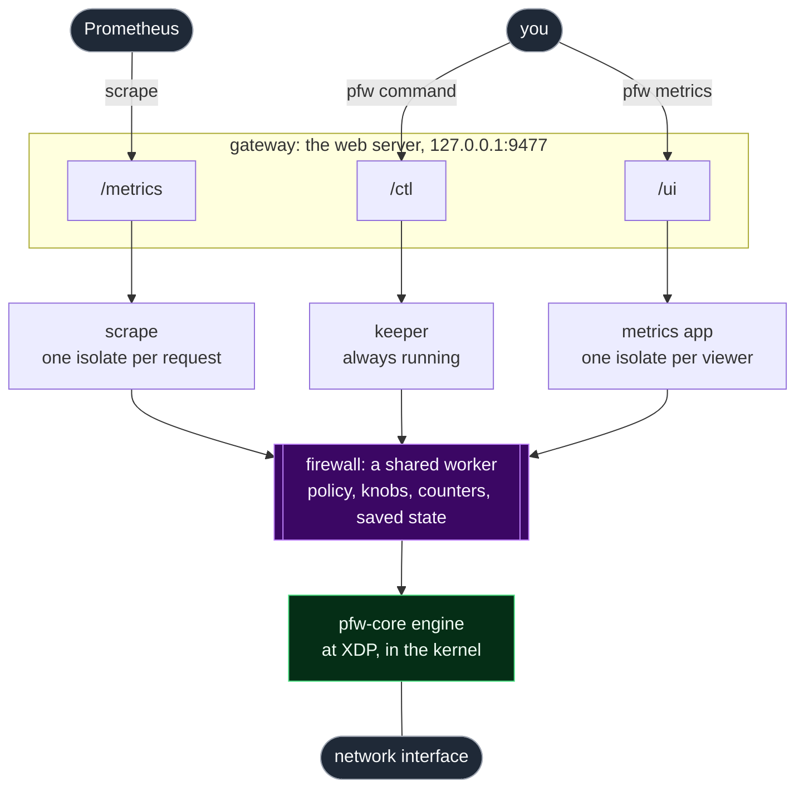
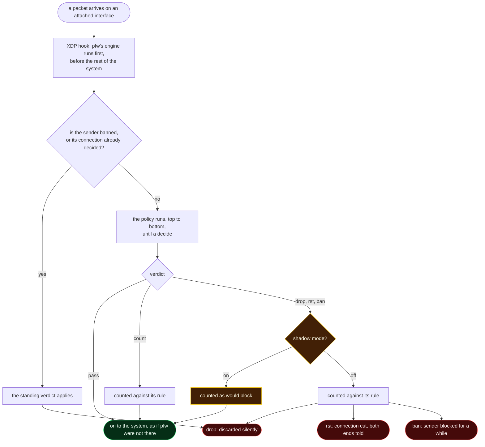
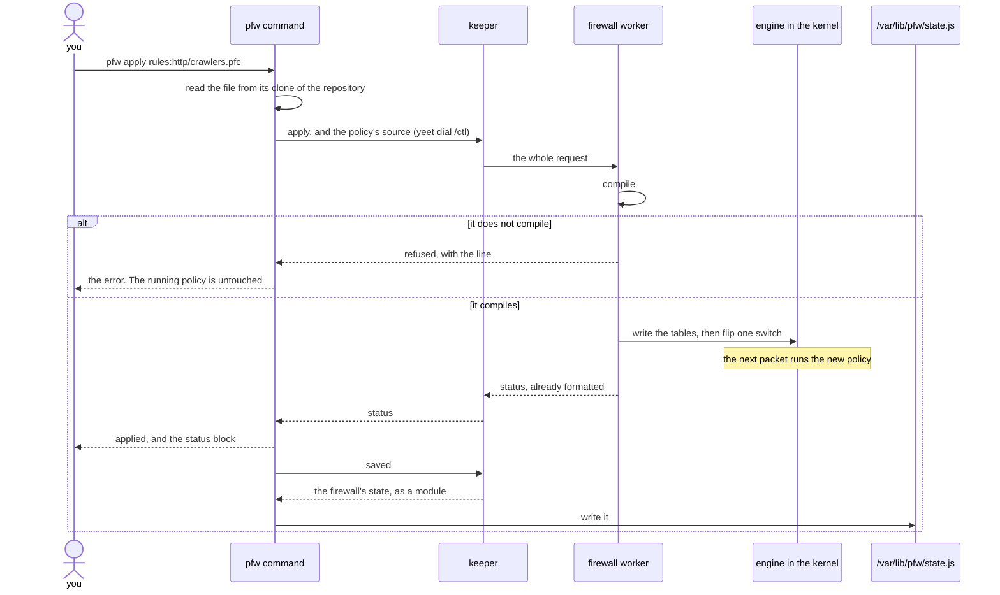

# How it works

pfw is three things: an engine that runs in the Linux kernel, a service that
looks after it, and a command that talks to the service.

<!-- diagram: architecture -->

<!-- /diagram -->

## The engine

[pfw-core](https://github.com/yeet-src/pfw-core) is a small virtual machine
for matching packets. It is loaded into the kernel once, at **XDP**: the
earliest point Linux offers, in the network driver, before a packet is given
to the rest of the system.

A policy is compiled to that machine's instructions and written into tables
the loaded program reads. So:

- **Applying a policy loads nothing new into the kernel.** The tables are
  written, then one switch is flipped, and the next packet runs the new
  policy. That is why a swap is instant and drops nothing.
- **A knob is a cell in a table.** Setting one is a single write.
- **Linux checks the engine once**, not every policy. The language is limited
  (no unbounded loops, fixed budgets) so that any policy is safe by
  construction.

### What happens to a packet

<!-- diagram: packet-path -->

<!-- /diagram -->

In shadow mode a blocking verdict is counted and the packet passes all the
same.

An interface has one XDP hook, which is why pfw owns the interfaces it is
attached to.

## The service

pfw runs as a [yeet](https://yeet.cx) service: JavaScript in isolates that
yeet starts, supervises and restarts. It has four parts.

| part | lives | does |
|---|---|---|
| **firewall** | as long as the keeper holds it | owns the engine: the policy, the knobs, the counters, the saved state |
| **keeper** | always | holds the firewall alive; serves `/ctl` and passes each command to it |
| **scrape** | for one request | asks the firewall for its counters and prints them for Prometheus |
| **metrics app** | for one viewer | draws the dashboard from what the firewall sends each second |

The firewall is a *shared worker*: one copy, which every other part reaches.
That matters because there can be only one holder of the XDP hook. The parts
that serve people come and go, one for each request or viewer, and none of
them can disturb the engine.

### What happens on `pfw apply 2`

<!-- diagram: apply -->

<!-- /diagram -->

1. `pfw` reads the policy file from its clone of the repository.
2. It connects to `/ctl` with `yeet dial` and sends the command and the file.
3. The keeper reads the whole request and hands it to the firewall.
4. The firewall compiles the policy. A mistake is sent back, and nothing else
   happens.
5. It writes the compiled policy into the engine's tables and flips the
   switch.
6. It sends back the status, already formatted for your terminal.
7. `pfw` asks the firewall for its state and writes that to disk.

### Why the service formats the output

`pfw status`, `ls`, `attach`, `knob ls` and the text of `metrics` are
rendered by the firewall and printed by `pfw` as they arrive. Every client
shows the same thing, and the logic is where it can be tested. The command
renders only what is about itself: `help`, `config`, `remote ls`, `doctor`.

A consequence: after an upgrade, output looks old until `pfw up` has moved
the firewall onto the new version. `pfw doctor` checks for that.

### Why the command saves the state

A yeet isolate has no disk. So the firewall cannot write down what it should
remember. Instead it hands its state to `pfw` as a small JavaScript module,
`pfw` writes it to `/var/lib/pfw/state.js`, and the firewall imports that
file when it next starts.

```mermaid
sequenceDiagram
    participant pfw as pfw command
    participant firewall as firewall worker
    participant disk as /var/lib/pfw/state.js

    Note over firewall: an isolate has no disk of its own

    rect rgb(30, 41, 59)
        Note over pfw,disk: after attach, detach, apply, clear, shadow, knob
        pfw->>firewall: saved
        firewall-->>pfw: interfaces, policy, knobs, shadow mode, as a JavaScript module
        pfw->>disk: write the module
    end

    rect rgb(20, 40, 30)
        Note over pfw,disk: on restart, upgrade or reboot
        firewall->>disk: import the module
        disk-->>firewall: the state as it was left
        firewall->>firewall: attach the interfaces, enforce the policy, set the knobs
    end
```

<!-- diagram: saved-state -->

<!-- /diagram -->

That is why saving works only from the machine the firewall runs on.

### Where a trial's timer runs

`pfw unshadow --confirm 10m` returns at once. The countdown is a timer in
the firewall worker, which holds what the firewall was doing before the
change. At the deadline it puts that back; `pfw confirm` cancels it. Nothing
on your side has to stay open, which is the point: the person who might be
locked out is the one who started it.

While a trial is pending, the state the firewall hands `pfw` to save is the
one before the trial, so a restart cannot make an unconfirmed change
permanent.

### Where the speeds come from

The engine only counts. Once a second the firewall reads its counters and
keeps the last minute of readings; a speed is the difference between two of
them. The dashboard's graphs are that minute.

## The command

`pfw` is a shell script. It does three things itself:

- **git**: cloning and fetching the repositories you named;
- **talking to the service**, one command per connection, through
  `yeet dial`;
- **writing to disk**: its own settings, and the firewall's saved state.

Everything else it asks the service for.

## Ports and paths

| what | where |
|---|---|
| the service's address | `127.0.0.1:9477` |
| `/metrics` | Prometheus text, one short-lived isolate a request |
| `/ctl` | the control route, a WebSocket |
| `/ui` | the dashboard, a terminal over a WebSocket |
| the command | `/usr/local/bin/pfw` |
| the service's files | `/usr/local/share/pfw` |
| saved state | `/var/lib/pfw/state.js` |
| settings and remotes | `~/.config/pfw` |
| cloned repositories | `~/.cache/pfw` |

The diagrams on these pages are kept in [`assets/`](../assets), one file
each.

More detail: [Developing](developing.md) for the source,
[Control protocol](protocol.md) for what crosses `/ctl`.
