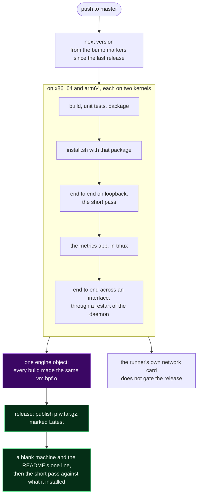

# Developing

Building pfw, testing it, and where things are. [How it works](architecture.md)
is the picture this fills in.

## Building

On Linux. On macOS, inside the Lima VM (see the repository's `AGENTS.md`).

```sh
make             # dist/: the four bundles, bin/vm.bpf.o and service.toml
make test        # unit tests under `yeet test`, and a syntax check of the shell scripts
make up          # pfw up on dist/: create or update the service, and start it
make down        # stop it
make remove      # stop it and remove the service from yeet
make e2e         # test/e2e.sh against the firewall that is up, on lo
make install     # pfw into $(PREFIX)/bin, the service into $(PREFIX)/share/pfw
make uninstall
make pkg         # pkg/pfw.tar.gz: what install.sh installs
make update      # move the pfw-core clone to its ref's newest commit
make clean       # remove build output (keeps the pfw-core clone)
make distclean   # and the clone
make help        # the list of targets
make V=1         # show the commands
```

`PREFIX` is `/usr/local` by default, and the install goes through `sudo`
where that is not yours to write: `make install PREFIX=~/.local` avoids it.

The build needs `make` and the `yeet` command, which supplies the toolchain
(esbuild, and clang for the engine). It picks the first `yeet` on `PATH` that
actually runs.

### pfw-core

The engine is [pfw-core](https://github.com/yeet-src/pfw-core). The build
clones it from `https://github.com/yeet-src/pfw-core.git` at `PFW_CORE_REF`
(default `master`) into `.deps/`, builds its `vm.bpf.o` there, and links it
into `node_modules` so both esbuild and the yeet runtime resolve `pfw-core`
as an installed package.

To build against a local checkout or an unpacked release instead:

```sh
make PFW_CORE=../pfw-core
```

Switching between the two forces a rebuild, so `dist/` never mixes them.

### What is built

`dist/` is the whole service:

| file | what it is |
|---|---|
| `index.js` | the keeper |
| `firewall.js` | the firewall shared worker, with pfw-core's compiler inside it |
| `scrape.js` | the Prometheus scrape isolate |
| `ui.js` | the metrics app |
| `bin/vm.bpf.o` | the engine, from pfw-core |
| `service.toml` | the service file |

`yeet service import dist` needs nothing else from the tree.

## Running a change

```sh
make up
```

That is `PFW_SOURCE=dist bin/pfw up`. It applies `dist/` as the `pfw`
service. A changed bundle stops the running firewall first: yeet would
otherwise start the new isolate beside the old one, and the old one holds the
XDP hook.

`service.toml` starts on `lo`. To try a change without touching `lo`, copy
`dist/` somewhere, point its `--iface` at a scratch interface (a veth pair
does well) and its `web-server` at another port, and run `pfw` with
`PFW_SOURCE`, `PFW_SERVICE`, `PFW_URL` and `PFW_CONFIG` set to match.

## Testing

```sh
make test
```

It runs four things:

- **the unit tests** in `test/*.test.js`, under `yeet test`. They cover what
  is pure: the metrics document, the text renderers, policy metadata, knobs,
  speeds and percentiles, trials and rollback, and the argument parsing;
- **`test/cli.sh`**: the `pfw` command where it needs no firewall. Its help,
  settings, remotes, pulling from a git repository it makes, the options it
  refuses, and what it offers the shell to complete, with bash driven as a
  completion drives it. Its settings are a temporary directory's and its
  service address is one nothing listens on;
- **`contrib/check.sh`**: every metric the alerts and the dashboard name is
  one pfw exports;
- **`assets/embed.sh --check`**: the diagrams in the pages match their
  files.

### A scratch firewall

```sh
make scratch                      # the end-to-end test, against a firewall made for it
sh test/scratch.sh                # a shell where `pfw` is a scratch firewall
sh test/scratch.sh pfw status     # one command
```

`test/scratch.sh` makes a second pfw service from `dist/`, on a port
(19477), a pair of virtual interfaces (`pfws0`, `pfws1`), a state file,
settings and a cache of its own, runs what it is given with `pfw` meaning
that one, and removes it all after. It refuses to go on if the firewall that
answers is not the scratch one. Use it on any machine whose own firewall
must be left alone.

### End to end

`test/e2e.sh` (`make e2e`) is the end-to-end test: against an installed
firewall it starts a web server and asks for a page as a browser and as a
crawler, with no policy, after `pfw setup`, on trial, after a trial ran out,
confirmed, rolled back, in shadow mode, with a knob changed, after a restart
in the middle of a trial, and cleared. It also follows `pfw logs` and reads
the exporter. It changes the firewall on the
host and stops it at the end, so outside CI it runs only with `PFW_E2E=yes`.
`E2E_ON=veth` runs it across a pair of virtual interfaces in place of
loopback, `E2E_DAEMON_RESTART=yes` adds a restart of the yeet daemon, and
`E2E_SHORT=yes` runs only the heart of it: a policy enforcing, a crawler cut
off, and a 60 kB upload read to its last byte.

`test/ui.sh` opens the metrics app in a tmux pane, sends it keys and a click,
and reads back what the pane shows. It changes nothing.

### Diagrams

The diagrams in the documentation are [Mermaid](https://mermaid.js.org),
one `.mmd` file each in `assets/`. Edit the file there, then copy it into the
pages that show it:

```sh
assets/embed.sh
```

A page says where a diagram goes with `<!-- diagram: NAME -->` and
`<!-- /diagram -->`. `make test` fails when a page is behind its file.

## CI and releases

`.github/workflows/ci.yml` runs on pull requests and on pushes to `master`
and `release/*`. A pull request is checked once, on x86_64. A push is
checked on x86_64 and on arm64, each on the newest runner image and an older
one, so on two kernels:

1. build, unit tests, package;
2. `install.sh` with that package, from outside the checkout;
3. the short pass of `test/e2e.sh` on loopback, where a segment is largest;
4. `test/ui.sh`: the metrics app, driven in a tmux pane with keys and a click;
5. all of `test/e2e.sh` across a pair of virtual interfaces, the client in a
   network namespace of its own, so the traffic arrives from elsewhere,
   including a restart of the yeet daemon, which has to bring the firewall
   back as it was, the way a reboot would.

Then, after a push, in jobs of their own:

- **one engine object**: every build above produced a byte-identical
  `vm.bpf.o`, which is what lets one package serve every architecture;
- **the runner's own network card**: the firewall attached to the card the
  default route uses, with a policy enforcing, and the runner still reaching
  the network. This one does not gate a release;
- **a blank machine and the README's one line**: nothing installed, then
  `curl … install.sh | sh`, which installs yeet, logs in, downloads the latest
  release and starts the firewall, and the short pass of the end-to-end test
  against that.

The end-to-end steps need the runner logged in to yeet, which serves a login
page in place of every route of a host that is not. `install.sh` logs in with
the key in the repository's `YEET_API_KEY` secret. Without the secret, as on
a pull request from a fork, CI builds, tests, packages and installs, skips
the rest with a warning, and releases nothing.

What CI cannot do: the browser login a person gets, a real reboot, and
kernels older than the oldest hosted image.

**A push to `master` that passes is released.** There is no tagging by hand:
CI works out the next version, publishes the package as that GitHub release,
and marks it Latest, which is what `install.sh` downloads.

<!-- diagram: release -->

<!-- /diagram -->

### Versions

Semver, `vMAJOR.MINOR.PATCH`, by the convention the other yeet repositories
use. The bump comes from a `[bump:LEVEL]` marker in the commit **subject**
(for a squash merge, the pull request's title):

| marker | bump | notes |
|---|---|---|
| *(none)* or `[bump:minor]` | **minor** `X.Y+1.0` | the default |
| `[bump:patch]` | **patch** `X.Y.Z+1` | only if **every** commit since the last release is `[bump:patch]` |
| `[bump:major]` | **major** `X+1.0.0` | one such commit makes the release major |

The release takes the highest level any commit since the last one asks for.
`commit-convention.yml` rejects a malformed marker, like `[bump:pacth]`, on
the pull request, so a typo cannot quietly ship as a minor.

```sh
git commit -m "fix the interface list on a host with none [bump:patch]"
```

The package says which release it is: `pfw --version`. A build of your own
says `dev`.

### Back-patching an older line

To ship a fix on an older release while `master` has moved on, branch the
line from its tag and merge fixes into it:

```sh
git branch release/v0.2 v0.2.0 && git push origin release/v0.2
```

A push to `release/*` runs the same workflow, versions within that line's
tags only, takes an unmarked commit as a **patch**, and does not take Latest
from the newer mainline release.

The dashboard can be looked at without a screen by running it in tmux and
capturing the pane:

```sh
tmux new-session -d -s shot -x 120 -y 36 "yeet dial ws://127.0.0.1:9477/ui"
sleep 3; tmux capture-pane -t shot -p; tmux kill-session -t shot
```

## The source

```
install.sh                yeet, a login, the command and the service, in one run
service.toml              the service: keeper, scrape, ui and gateway units, and the routes
bin/pfw                   the command

src/main.js               the keeper: opens the worker and holds it, serves `ctl`
src/firewall.js           the shared worker: owns the firewall, answers everyone else
src/scrape.js             one scrape: a per-connection isolate on the console portal
src/config.js             yeet.args -> first interfaces, object path, state file
src/worker/protocol.js    what crosses the worker's port
src/worker/link.js        the keeper's end of that port

src/fw/firewall.js        the PfwVm and the policy it enforces (the only kernel-aware module)
src/fw/policy.js          pfw-C source compiled, or refused with its errors
src/fw/meta.js            a policy's `@key` metadata, from its opening comments
src/fw/knobs.js           knob values, kept per policy
src/fw/rates.js           the counters sampled each second: speeds and percentiles
src/fw/name.js            a policy's name, and the key that outlives its revision
src/fw/trial.js           a change that undoes itself at a deadline unless confirmed
src/fw/saved.js           the state as a module, restored at start
src/fw/interfaces.js      the host's interfaces, from yeet's system graph
src/metrics/document.js   status + stats -> a yeet:telemetry document (pure)

src/ctl/portal.js         the `ctl` portal, in the keeper: one command per peer
src/ctl/request.js        a request's framing: header, then counted sources
src/ctl/stream.js         a portal peer read as a byte stream
src/ctl/reply.js          a request run against the firewall, in the worker
src/ctl/commands.js       the commands
src/ctl/select.js         which policies a listing shows: remote, tag, severity, words
src/ctl/render/           replies as text: palette, status, metrics, lists, bars

src/ui/main.jsx           the metrics app: status bar, tabs, keys and mouse
src/ui/pages.jsx          its four pages: where each box goes, what a click means
src/ui/views.js           what the boxes say, as rows of colored runs (pure)
src/ui/panel.jsx          a box with its title in the border, and the scrolling list
src/ui/line.jsx           a row drawn, and rows aligned into columns
src/ui/feed.js            its line to the worker, asked once a second

completions/              bash and zsh completion: thin, `pfw __complete` does the work
contrib/                  a Prometheus scrape job and alerts, a Grafana dashboard
assets/                   the diagrams, as Mermaid
assets/pfw-tui.gif        the dashboard, as the README shows it
assets/social-preview.png the picture a link to the repository unfurls to

test/*.test.js            `yeet test` cases
test/cli.sh               the command without a firewall
test/e2e.sh               the command and a firewall, with real traffic
test/scratch.sh           a scratch firewall to run either against
test/ui.sh                the metrics app, in a tmux pane
build/                    toolchain glue, from the yeet project template
```

## Things that are easy to get wrong

- **A message port nothing refers to is garbage-collected**, and messages to
  it then vanish. The firewall keeps every open port in a set for that
  reason.
- **A yeet isolate has no filesystem, no fetch and no exec.** That is why
  git lives in `bin/pfw`, and why state is saved by the command.
- **`yeet dial` forwards a pipe in arbitrary chunks**, so the control
  protocol frames policy source by byte count.
- **The service closes a control connection as soon as it has answered**,
  which can beat `yeet dial` to its end-of-input and make it exit non-zero.
  `pfw` counts any reply as a reply.
- **yeet spells a flag's hyphens as underscores**: `--state-file` arrives as
  `state_file`.
- **Leading and trailing spaces in a text run are trimmed** by the terminal
  toolkit. The dashboard uses non-breaking spaces where a space must stay.
- **`die` inside `$(...)` ends only the subshell.** A refusal there has to be
  caught where the substitution is: `names=$(chosen "$1") || exit 1`. Never
  `for each in $(something that may die)`.
- **A pipe into `ask` loses the reply**, which is a shell variable: the last
  stage of a pipe runs in a subshell. Send from a here-document or a file.
- **A trial's snapshot is taken before its change**, and the time is parsed
  before either, so a bad time or a policy that does not compile changes
  nothing and starts no trial.
- **The palette is in two places**: `src/ctl/render/palette.js` for what the
  service renders, and the top of `bin/pfw` for what the command renders.

## The package

```sh
make pkg
```

makes `pkg/pfw.tar.gz`: `bin/pfw`, `share/pfw/` and the two completion
files, laid out as a prefix holds them, so installing is unpacking. Its bundles are minified.

One package serves every architecture. The bundles are JavaScript, the
command is a shell script, and the engine (`vm.bpf.o`) is BPF bytecode, which
the kernel loads the same on any of them. CI holds that to be true on every
push.
