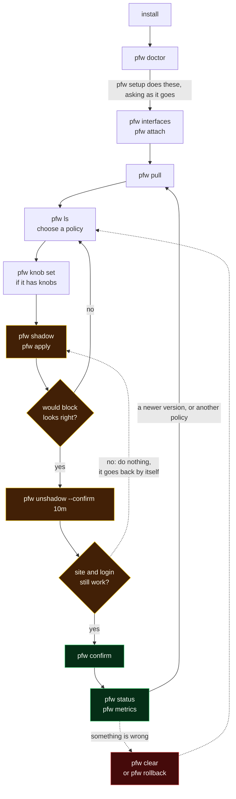

# Getting started

From a fresh [install](install.md) to a policy that is really blocking, in
six steps. Each shows what you should see.

## The short way

```sh
pfw setup
```

asks which interface to protect and which policy to use, sets the policy's
knobs, and leaves it rehearsing in shadow mode, blocking nothing. That is
steps 1 to 4 below. Then go to [step 5](#5-enforce-it).

It can be told the answers instead of asking:

```sh
pfw setup --iface eth0 --policy rules:http/crawlers.pfc --knob port=8080 --yes
```

The steps one at a time, so you know what each does:

## 1. See that it is up

```sh
pfw status
```

```
● pfw  up 12s   on lo
  policy   none: passing everything
  packets  48 seen   pass 0   drop 0   rst 0   cut off 0
```

- **`up`** and the green dot: the firewall is running.
- **`on lo`**: it is attached to `lo`, the *loopback* interface, which is
  traffic from this machine to itself. pfw starts there because nothing you
  care about breaks there.
- **`policy none`**: it has no rules yet, so everything passes.

If you see `the pfw service is not reachable`, run `pfw up`, and if that
fails, `pfw doctor`.

## 2. Choose the interface to protect

```sh
pfw interfaces
```

```
▸  lo    up  127.0.0.1/8      attached  loopback: this machine talking to itself
   eth0  up  203.0.113.7/24             default route: traffic from the network arrives here

to filter traffic from the network: pfw attach eth0
```

That lists your machine's network interfaces and says which is which. The one
marked `default route` is where traffic from outside arrives, and the last
line is the command to attach to it. Run it, and let go of `lo`:

```sh
pfw attach eth0
pfw detach lo
```

Still nothing is blocked: there is no policy. More in
[Interfaces](interfaces.md).

## 3. Get some policies

```sh
pfw pull
pfw ls
```

```
  1 ✔ rules:baseline/pass.pfc  1 rule
      Passes everything: attached and counting, deciding nothing.
      #baseline
  2 ✔ rules:http/crawlers.pfc  2 rules
      Resets AI crawlers on a web port by user-agent.
      #http  #crawlers
      knob  port  80  The port to guard.
```

`pull` downloads the policies from the public
[pfw-rules](https://github.com/yeet-src/pfw-rules) repository; `ls` lists
them, in groups. There are more than these two, and `pfw ls crawlers` or
`pfw ls --tag java` narrows the list. Reading one entry:

- **`2`** is its number, a shortcut for its name. Numbers follow the list, so
  they change when policies are added; the name does not.
- **`✔`** means it compiles. A `✘` would show the error instead.
- **`rules:http/crawlers.pfc`** is its full name: the repository, then the
  file.
- The next line is what it does, then its tags.
- **`knob port 80`** is a value you can change without editing the policy.
  See [Knobs](knobs.md).

## 4. Try one without blocking anything

```sh
pfw shadow
pfw apply rules:http/crawlers.pfc
```

`shadow` turns on the dry run. `apply` puts that policy in place (its number
from the list would do as well). Now let some
traffic through for a while, then look:

```sh
pfw status
```

```
● pfw  up 4m 10s   on eth0   shadow mode: nothing is blocked
  policy   rules:http/crawlers.pfc @ b58a001   shadow (dry run)   applied 2m ago
  packets  1.9k seen   pass 1.9k   drop 0   rst 0   cut off 0   would block 37
  rules    crawler 37
```

**`would block 37`** is the number to read: what the policy would have
stopped, had it been real. `rules` says which rule would have stopped them.

If that looks right, and nothing you need is in it, go on. If not, try
another policy, or [change a knob](knobs.md), and look again.

## 5. Enforce it

```sh
pfw unshadow --confirm 10m
```

From the next packet, the policy is real, **on trial for ten minutes**.
`pfw status` says `enforcing`, with a line counting down:

```
  trial    undone in 9m 41s   pfw confirm keeps it, pfw rollback undoes it now
```

Check that your site still loads and that you can still log in to the
machine. Then keep it:

```sh
pfw confirm
```

If you do nothing, or cannot, the ten minutes run out and the policy goes
back to rehearsing by itself. That is the point: a policy that cuts you off
does not keep you off. Plain `pfw unshadow` enforces with no trial.

## 6. Watch it work

```sh
pfw metrics
```

This opens the dashboard. `1` to `4` or a click change page, the arrow keys
and the mouse wheel scroll, and `q` leaves. [Metrics](metrics.md) explains
every box.

## The loop

That is all of it:

**pull → list → shadow → apply → check → unshadow on trial → confirm**

<!-- diagram: workflow -->

<!-- /diagram -->

## Where next

- [Deploying, step by step](deploy.md): the careful version of this, for a
  machine with real traffic on it.
- [Using policies](policies.md): your own repositories, updating, clearing.
- [Writing a policy](writing-policies.md): make one of your own.
- [Security](security.md): before pfw's port is reachable from anywhere else.
- If you blocked something you need: `pfw rollback` goes back to the policy
  before, and `pfw clear` lets everything through, both without stopping pfw.
- Tab completion for bash and zsh is installed with pfw: `pfw app<Tab>`,
  `pfw apply rules:<Tab>`. Open a new shell to pick it up.
