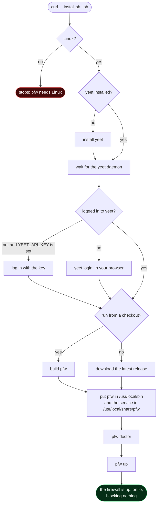

# Installing

## What you need

- **A Linux machine**, with kernel 6.1 or newer. `uname -r` prints yours. pfw
  does not run on macOS or Windows, except inside a Linux virtual machine.
- **Administrator rights** on it (`sudo`). Attaching to a network interface
  is a privileged thing to do, and pfw installs under `/usr/local`.
- **`git` and `curl`.** Most systems have both; if not, they are in your
  package manager (`sudo apt install git curl`).
- **A [yeet](https://yeet.cx) account.** pfw runs on yeet. The installer
  installs it and asks you to log in.

## The installer

```sh
curl -fsSL https://raw.githubusercontent.com/yeet-src/pfw/master/install.sh | sh
```

What it does, in order, stopping at the first thing it cannot put right:

| step | what happens |
|---|---|
| linux | checks this is Linux, with `tar` and `git` |
| yeet | finds yeet; when it is missing, installs it with `curl -fsSL https://yeet.cx \| sh` |
| daemon | waits for yeet's background service to answer |
| login | checks this machine is logged in to yeet; when it is not, runs `yeet login` |
| pfw | downloads the pfw package from the latest release |
| install | puts `pfw` in `/usr/local/bin` and the service's files in `/usr/local/share/pfw`, with `sudo` |
| doctor | runs `pfw doctor` and shows you the result |
| up | starts the firewall |

<!-- diagram: install -->

<!-- /diagram -->

Each step prints a line. One that fails says what to do, and the installer
can be run again.

When it finishes, the firewall is **running and blocking nothing**. It is
attached to `lo`, the machine talking to itself, and has no policy.
[Getting started](getting-started.md) takes it from there.

### Options

Pass them after `sh -s --`:

```sh
curl -fsSL https://raw.githubusercontent.com/yeet-src/pfw/master/install.sh | sh -s -- --no-up
```

| option | effect |
|---|---|
| `--prefix DIR` | install under `DIR` instead of `/usr/local` (`DIR/bin/pfw`, `DIR/share/pfw`) |
| `--package SRC` | install this package, a file or a URL, instead of the latest release |
| `--no-login` | do not require a yeet login |

To install on a machine nobody is sitting at, set `YEET_API_KEY`: the
installer logs in with that key and opens no browser.

```sh
curl -fsSL https://raw.githubusercontent.com/yeet-src/pfw/master/install.sh | YEET_API_KEY=… sh
```

| `--no-up` | install only; start the firewall later with `pfw up` |

## Checking the install

```sh
pfw doctor
```

Every line should start with `✔`. A `▲` is something to look at; a `✘` has to
be fixed, and the fix is printed under it. See
[Troubleshooting](troubleshooting.md).

## From the source

```sh
git clone https://github.com/yeet-src/pfw.git
cd pfw
./install.sh
```

Run from a checkout, the installer builds pfw first, so it also needs `make`.
The build is described in [Developing](developing.md).

## Upgrading

Run the installer again. It replaces the command and the service's files and
runs `pfw up`, which notices the build changed and restarts the firewall onto
it. Your interfaces, policy, knobs and shadow mode come back as they were.

The firewall is down for the moment it restarts, and traffic is not filtered
during it. `pfw up` says so when it happens.

## Uninstalling

```sh
pfw down
yeet service remove pfw
sudo rm -rf /usr/local/bin/pfw /usr/local/share/pfw /var/lib/pfw
rm -rf ~/.config/pfw ~/.cache/pfw
```

| path | what it holds |
|---|---|
| `/usr/local/bin/pfw` | the command |
| `/usr/local/share/pfw` | the service's files |
| `/var/lib/pfw` | what the firewall remembers across restarts |
| `~/.config/pfw` | your settings and your list of remotes |
| `~/.cache/pfw` | the policy repositories pfw has cloned |
