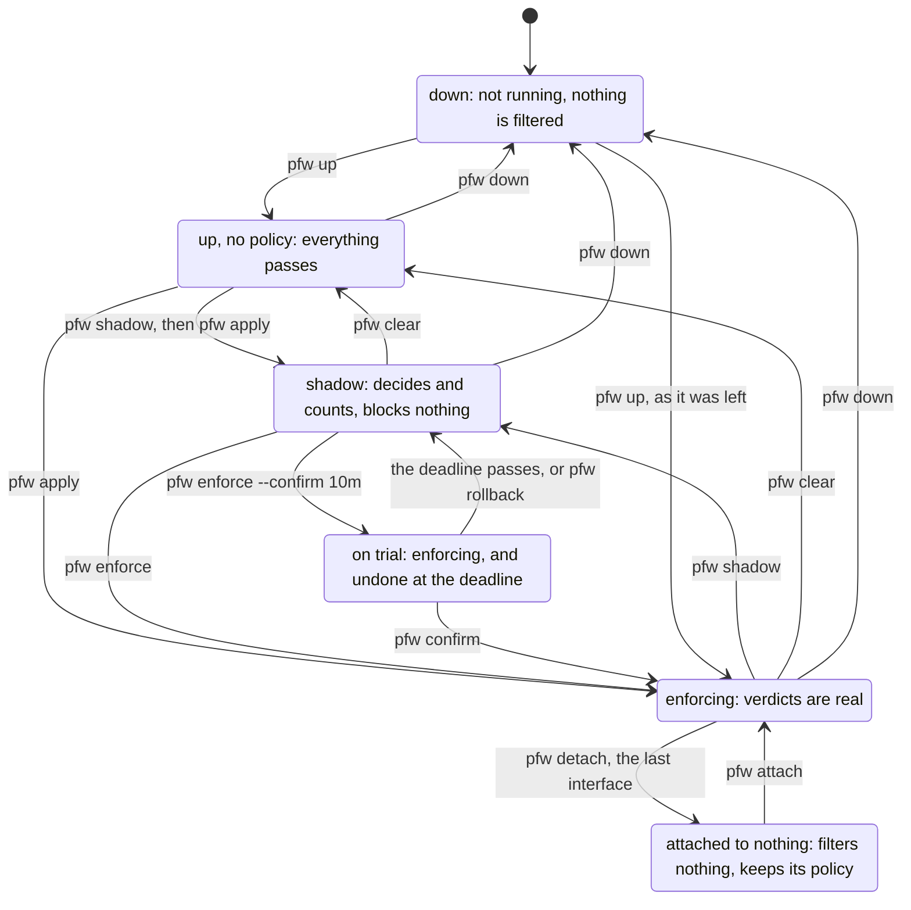

# Using policies

A **policy** is one file ending in `.pfc`: the program pfw runs on every
packet. One policy is the usual setup; pfw can also run
[several at once](#several-policies-at-once), each for packets of its own.
Policies live in git repositories, which pfw calls **remotes**.

## Remotes

```sh
pfw remote ls
```

```
  rules  https://github.com/yeet-src/pfw-rules.git  default branch at b58a001
```

`rules`, the public [pfw-rules](https://github.com/yeet-src/pfw-rules)
repository, is there from the start. Add your own beside it:

```sh
pfw remote add acme https://github.com/acme/policy.git
pfw remote add acme git@github.com:acme/policy.git -r v1.4.0    # a branch, tag or commit
pfw remote rm acme
```

- The name (`acme`) is yours to choose: letters, digits, dot, dash,
  underscore.
- The URL is anything `git clone` takes. A private repository works if your
  git can already reach it.
- `-r` pins a branch, tag or commit. Without it, pfw follows the repository's
  default branch.
- Removing `rules` removes it for good; it does not come back.

## Pulling

```sh
pfw pull          # every remote
pfw pull acme     # one
```

```
✔ rules  fc5a1f0 → b58a001
  ~ http/crawlers.pfc
```

`pull` downloads what is new and says what changed: `+` added, `~` changed,
`-` removed. **Pulling changes nothing about what is running.** A newer
version of your policy is not in effect until you apply it.

## Listing

```sh
pfw ls
```

```
apps
   1 ✔ rules:apps/confluence-remote-api.pfc   3 rules
       Resets every request for Confluence's Remote API, SOAP and XML-RPC.
       CVE-2026-90436  critical  patches Atlassian Confluence Data Center 1.x to 9.x  #http  #java  #rce
   2 ✔ rules:apps/litellm-guardrails.pfc      2 rules
       …

http
   6 ✔ rules:http/crawlers.pfc                2 rules
       Resets AI crawlers on a web port by user-agent.
       #http  #crawlers
       knob  port  80  The port to guard.

runtimes
▸  8 ✔ rules:runtimes/log4shell.pfc           4 rules   active
       …
```

The list is in groups, one for each directory of the repository, which is how
a rules repository says what a policy shields.

| part | meaning |
|---|---|
| the heading | the directory the policies under it are in |
| the number | a shortcut for the policy's name |
| `✔` / `✘` | it compiles, or the error that stops it |
| `rules:http/crawlers.pfc` | its name: remote, then path |
| `▸ … active` | the one in place now |
| `active at a1b2c3d, this is b58a001` | the one in place is an older version; apply it to move forward |
| the indented lines | what the policy says about itself: description, CVEs, severity, what it patches, tags |
| `knob …` | a value you can set; see [Knobs](knobs.md) |

The running service does the compiling, so `ls` needs pfw to be up. When it
is not, you get the bare list.

### Finding one

With more than a screenful, narrow it:

```sh
pfw ls log4j                      # a word: in the name, description, a CVE, a tag, or what it patches
pfw ls CVE-2021-44228             # so a CVE number finds its policy
pfw ls --tag java                 # by tag
pfw ls --severity critical        # by severity
pfw ls rules                      # one remote, by its name
```

They combine, and each narrows further:

```sh
pfw ls --tag java --tag rce --severity critical
pfw ls rules tomcat
```

```
apps
  1 ✔ rules:apps/confluence-remote-api.pfc  3 rules
  4 ✔ rules:apps/roller-xmlrpc.pfc          2 rules

runtimes
▸ 8 ✔ rules:runtimes/log4shell.pfc          4 rules   active

3 of 10 policies
```

| filter | chooses |
|---|---|
| a word | policies with it in their name, description, CVEs, tags or what they patch; several words, all of them |
| a remote's name | that remote's policies |
| `--tag TAG`, `-t` | policies carrying the tag; given twice, both |
| `--severity LEVEL`, `-s` | `critical`, `high`, `medium` or `low`; given twice, either |

Matching ignores upper and lower case. **A number is the same in a narrowed
list as in the whole one**, so you can find a policy with a filter and apply
it by the number you see.

**Numbers are for now, all the same.** They follow the whole list, so a pull
that adds or removes a policy shifts them. In a script, and anywhere it
matters, use the name.

## Applying

```sh
pfw apply 2                          # by number
pfw apply rules:http/crawlers.pfc    # by name
pfw apply http/crawlers.pfc          # the path alone, when there is one remote
pfw apply -f ./mine.pfc              # a file, no git involved
pfw apply                            # lists them and asks
```

`pfw load` is another name for `apply`.

- **It is checked first.** A policy with a mistake is refused, with the line,
  and the one running stays in place.
- **It swaps in at once.** The next packet meets the new policy. Connections
  already being tracked, and standing bans, carry over.
- **Open connections are followed from where it picks them up.** Most of the
  public policies follow a connection so they can read a request split
  across packets, and a connection already open when one is applied is
  followed from its next segment. The exception is a policy that decodes
  the stream (`decode h2` and the like): a decode cannot begin part-way, so
  connections already open on its port are reset once, and clients
  reconnect. Swapping policies, changing a knob, and traffic on other ports
  drop nothing.
- **Rule counts start from zero** for the new policy.
- **It is remembered.** After a restart pfw comes back enforcing it.

## Shadow mode

```sh
pfw shadow        # on
pfw enforce      # off
```

In shadow mode the policy decides and counts exactly as usual, and every
packet passes. `pfw status` shows it on the first line and adds
`would block N`: what would have been stopped.

Use it whenever a policy is new to you:

```sh
pfw shadow
pfw apply 2
# ... let real traffic through ...
pfw status
pfw enforce
```

Shadow mode belongs to the firewall, not to a policy: it stays on across
`apply` and across restarts until you turn it off.

## On trial

A policy that blocks the wrong thing can block you. So the two commands that
start blocking can be made to undo themselves:

```sh
pfw enforce --confirm 10m       # enforce, for ten minutes
pfw apply rules:http/crawlers.pfc --confirm 10m     # or a new policy, for ten minutes
```

The change takes effect at once, and the firewall undoes it when the time is
up, going back to what it was doing before, unless you keep it first:

```sh
pfw confirm
```

`pfw status` shows the countdown:

```
  trial    undone in 9m 41s   pfw confirm keeps it, pfw rollback undoes it now
```

- **The time** is a number and `s`, `m` or `h`: `90s`, `10m`, `1h`. From 5
  seconds to 24 hours. `--confirm` alone means `10m`.
- **The timer is in the firewall**, not your terminal. Closing the terminal,
  or losing your connection, does not cancel it. That is what it is for.
- **`pfw rollback`** undoes the trial now, without waiting.
- **Everything you change during a trial is part of it.** A second
  `--confirm` moves the deadline; what it goes back to is still the last
  state you confirmed.
- **A restart during a trial** comes back to what was running before it.
- After one runs out, `pfw status` says `not confirmed: went back 3m ago`
  until the next change.

## Rolling back

```sh
pfw rollback
```

With a trial pending, it undoes the trial. Otherwise it puts back **the
policy that was in place before this one**, with the knobs you had set for
it, and the one it replaced becomes the one before, so a second `rollback`
returns. After a `clear`, it puts the cleared policy back. With several
policies in place it is the last change that is undone, whichever place it
was in. What was before is remembered across restarts.

It changes the policy only: interfaces and knobs stay as they are.

## Clearing

```sh
pfw clear
```

Removes every policy. Everything passes, pfw stays attached and keeps
counting packets. This is the fast way out when a policy is blocking
something it should not. Bans already in place still stand until they
expire. `pfw rollback` puts back what was cleared.

`pfw clear` with a place (`--port 8443`, `--first`, `--default`) removes
only what is there.

## The states pfw can be in

<!-- diagram: states -->

<!-- /diagram -->

## Several policies at once

`pfw apply POLICY` makes a policy the **default**: every packet runs it. To
run another beside it, say which packets the other is for.

```sh
pfw apply rules:http/waf.pfc                        # the default
pfw apply rules:http/api.pfc --port 8443            # tcp port 8443 has its own
pfw apply rules:dns/guard.pfc --port udp/53         # and so does DNS
pfw apply rules:tenant.pfc --dst 10.1.0.0/16        # a destination prefix
pfw apply rules:ssh.pfc --dst 10.1.2.3 --port 22    # one address, one port
pfw apply rules:edge.pfc --iface eth1               # what arrives on one interface
```

Each of those is a **route**: a policy, and the packets it is for.

- **A packet runs one policy.** A routed packet runs its route's policy
  **in place of** the default, not after it. The default is for whatever no
  route claims, and with no default those packets pass.
- **The more specific route wins.** The longest `--dst` prefix the packet's
  destination is in decides first; a route with no `--dst` is the shortest
  of all. Between routes with the same prefix, one that names a port wins,
  then a protocol, then an interface.
- **Applying to a route again swaps its policy**, as `apply` does the
  default's. `pfw clear --port 8443` removes that route, and its packets go
  back to whatever else claims them.
- **A route by interface needs pfw attached to it**, and the interface
  cannot be detached while a route names it.

### Policies that run first

```sh
pfw apply rules:net/blocklist.pfc --first
pfw apply rules:net/flood.pfc --first
```

A policy applied with `--first` runs on **every** packet, before the
packet's own policy: a blocklist ahead of each port's rules. It blocks the
packet, or passes it on. Up to eight run, in the order you applied them.
Applying one that is already in the chain replaces it where it stands;
`pfw clear --first` removes them all.

A policy run first sees packets as they arrive. It cannot follow a stream,
so one that says `reassemble` or `decode`, or rewrites what it reads, is
refused there: give it a route, or make it the default.

### What they share

- **Shadow mode, a trial and `rollback` are the firewall's.** `pfw shadow`
  rehearses every policy; `--confirm` works on any `apply`.
- **Knobs are not shared.** Two policies in place that both read `port`
  each have their own value. A policy in more than one place has one set of
  knobs for all of them. See [Knobs](knobs.md).
- **Bans stand whatever policy a packet would run.**
- **Each has its own rules and counts.** `pfw status` and `pfw metrics` say
  whose a rule is, as `crawler (tcp/8443)`.

```
● pfw  up 3d 4h   on eth0
  policy   rules:http/waf.pfc @ b58a001   enforcing   applied 2h ago
  first    rules:net/blocklist.pfc @ b58a001   enforcing   applied 2h ago
  route    tcp/8443  rules:http/api.pfc @ b58a001   enforcing   applied 5m ago
```

At most 64 policies are in place at once.
